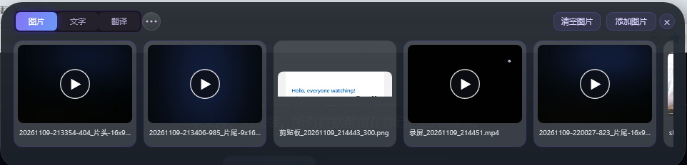
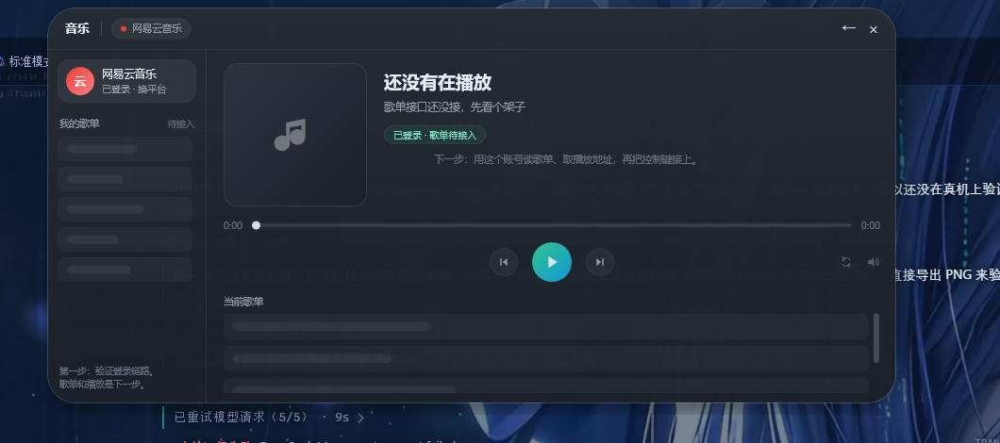
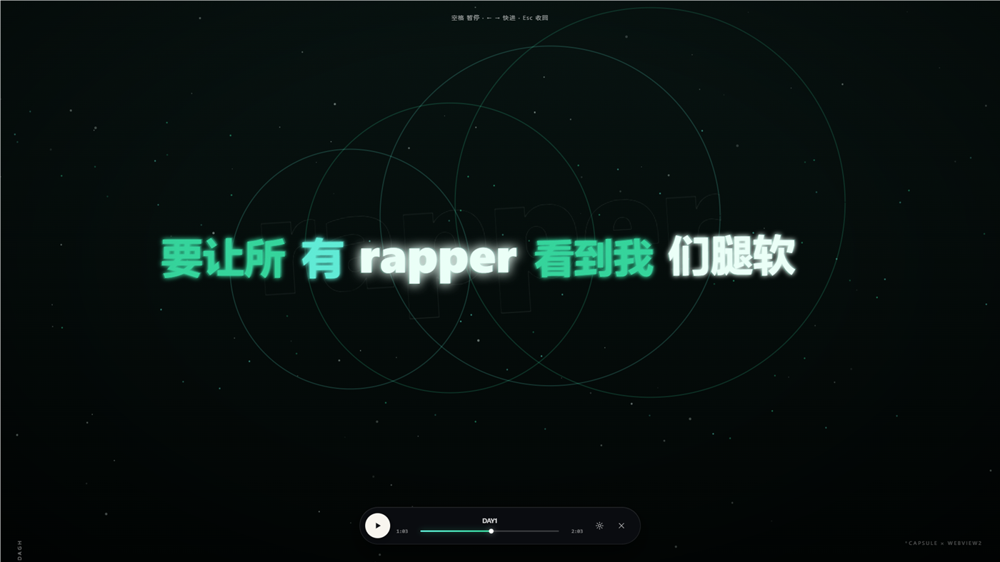

# Myriad Isle Pro · 万象岛 Pro

**English** | [简体中文](README.md)

> A "Dynamic Island" capsule for Windows that lives at the top of your screen: capture screenshots, annotate them, translate any region of the screen, watch Douyin in a floating window, and play music with desktop lyrics — all from one tiny pill.



<p align="center">
  
  
  
  
  
</p>

> ⭐ If this tool saves you time, a star helps others find it — that is the only "payment" this project asks for.

---

## What is it

A slim glass capsule pinned to the top edge of your desktop, inspired by the iPhone's Dynamic Island:

- **Screenshots fly into it.** Capture a region, a window, or the whole screen — the image lands in the capsule. No popups, no file dialogs, no hunting through folders.
- **Annotate without Photoshop.** Arrows, rectangles, freehand, highlighter, text, callouts, numbered steps, blur, mosaic, crop.
- **Translate anything on screen.** Press a hotkey, drag a box over any text, and the Chinese translation is painted back on top of the original.
- **Douyin in a floating window.** A always-on-top landscape window that runs the web version, so you can scroll while working.
- **Music with desktop lyrics.** A built-in player with playlists, cover art and full-screen lyrics projected onto your desktop.
- **WeChat / QQ unread hints.** A small hint appears beside the capsule when a new message arrives; click it to jump straight to that window.

Everything runs locally. No account, no analytics, no cloud upload.

## Features

| Module | What it does |
| --- | --- |
| 📸 **Capture** | Region / window / full screen, optionally with a magnifier while selecting |
| 🖼️ **Image shelf** | Thumbnails inside the capsule; hover to preview, click to open, drag straight into WeChat / QQ / Explorer |
| ✏️ **Annotate** | Rect, ellipse, arrow, line, pen, highlighter, text, callout, numbered steps, blur, mosaic, crop, undo/redo |
| 📝 **Text** | Any copied text is collected into the capsule; copy back, pin, translate |
| 🌐 **Translate** | Text translation and **region translation** (OCR + overlay); engine: free MyMemory or your own OpenAI-compatible model |
| 📱 **Douyin window** | Always-on-top landscape window with the web version of Douyin |
| 🎵 **Music** | Playlists, queue, cover art, lyrics; **lyrics can be projected onto the desktop** |
| 💬 **WeChat / QQ** | Unread hint beside the capsule; left half opens WeChat, right half opens QQ |
| 🎬 **Recorder** | One-key MP4 recording via ffmpeg (`ddagrab`, falls back to `gdigrab`) |

## Screenshots

<p align="center">
  
</p>

<p align="center">
  
</p>

<p align="center">
  
</p>

## Download

**Get the latest zip from [Releases](https://github.com/pl514/myriad-isle-pro/releases/latest).**

```
1. Download  MyriadIslePro-3.20.zip  (~0.8 MB)
2. Extract anywhere (avoid C:\Program Files — running without admin is simpler)
3. Double-click  MyriadIslePro.exe
4. A capsule appears at the top of your screen
```

### Requirements

| Item | Requirement |
| --- | --- |
| OS | Windows 10 / 11, 64-bit |
| Runtime | .NET Framework 4.8 (bundled with Win10 1903+ / Win11) |
| Web engine | Microsoft Edge WebView2 Runtime (bundled with Win11) |
| Recorder | Optional: ffmpeg in PATH or next to the exe |

### Antivirus note

The executable is **not code-signed**, so Defender / 360 / Huorong may warn on first run. Add the extracted folder to your trusted list.

## Quick start

1. **Capture** — `Ctrl + Alt + Shift + A`, drag a region; the image drops into the capsule.
2. **Edit** — click an image in the capsule, then the edit icon.
3. **Use** — drag an image from the capsule into WeChat / QQ / Explorer, or right-click → Copy.
4. **Translate** — `Ctrl + Alt + Shift + F`, drag over any text; the translation is painted in place.
5. **Explore** — click `•••` beside the capsule: Douyin, AI, Music.

## Hotkeys

All hotkeys are configurable (tray icon → 更多操作 → 快捷键设置).

| Action | Default |
| --- | --- |
| Show / hide capsule | `Ctrl + Alt + Shift + Space` |
| Region capture | `Ctrl + Alt + Shift + A` |
| Window capture | `Ctrl + Alt + Shift + 2` |
| Full-screen capture | `Ctrl + Alt + Shift + 3` |
| Collapse / expand images | `Ctrl + Alt + Shift + H` |
| Start / stop recording | `Ctrl + Alt + Shift + R` |
| Douyin window | `Ctrl + Alt + Shift + D` |
| Region translate | `Ctrl + Alt + Shift + F` |

## Data & privacy

**Everything is local.** Nothing is uploaded (except the translation service you choose to use).

```
MyriadIslePro.exe
data\
├── images\        captured images
├── screenshots\   clipboard images
├── Recordings\    recordings
├── translate-img\ image translation results
├── settings.txt
└── hotkeys.txt
```

Portable by design: copy the folder to migrate, delete `data\` to reset. Autostart writes to the per-user `Run` key — no UAC prompt.

## FAQ

<details>
<summary><b>Nothing happens when I double-click</b></summary>

Usually antivirus interception or a missing WebView2 runtime. Check for a dialog first; otherwise add the folder to your trusted list and install the WebView2 runtime.
</details>

<details>
<summary><b>Dragging an image into WeChat fails</b></summary>

Windows blocks drag-and-drop from a lower-integrity process to a higher one. Run Myriad Isle **without** administrator rights and outside sandboxes / remote sessions.
</details>

<details>
<summary><b>Translation says "quota exceeded"</b></summary>

MyMemory has a daily free quota. Wait, or configure your own OpenAI-compatible model in settings (DeepSeek, Zhipu and others offer free tiers).
</details>

<details>
<summary><b>Hotkey does nothing</b></summary>

Another app probably owns the combination (IME, recording tools). Change it in the hotkey settings — the app reports whether registration succeeded.
</details>

## Build from source

No Visual Studio, no NuGet — just the `csc.exe` bundled with .NET Framework 4.8:

```powershell
.\Build.ps1
```

Output: `build\MyriadIslePro.exe` (WebView2 SDK from `vendor\webview2` is copied alongside).

Tech stack: WPF (.NET Framework 4.8), WebView2, GDI / Desktop Duplication for capture, ffmpeg for recording, `Windows.Media.Ocr` for OCR, and a fair amount of P/Invoke (window management, DWM, audio session APIs).

## Contributing & license

- [Contributing guide](CONTRIBUTING.md)
- [Disclaimer](DISCLAIMER.md) — read this before use
- Licensed under [MIT](LICENSE)

---

<p align="center">
  <sub>Myriad Isle Pro · screenshots that don't interrupt your flow</sub>
</p>
