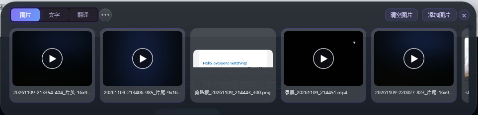
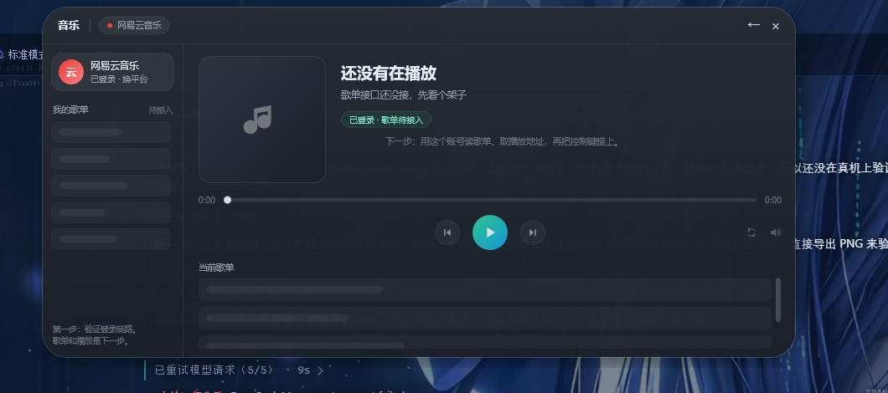
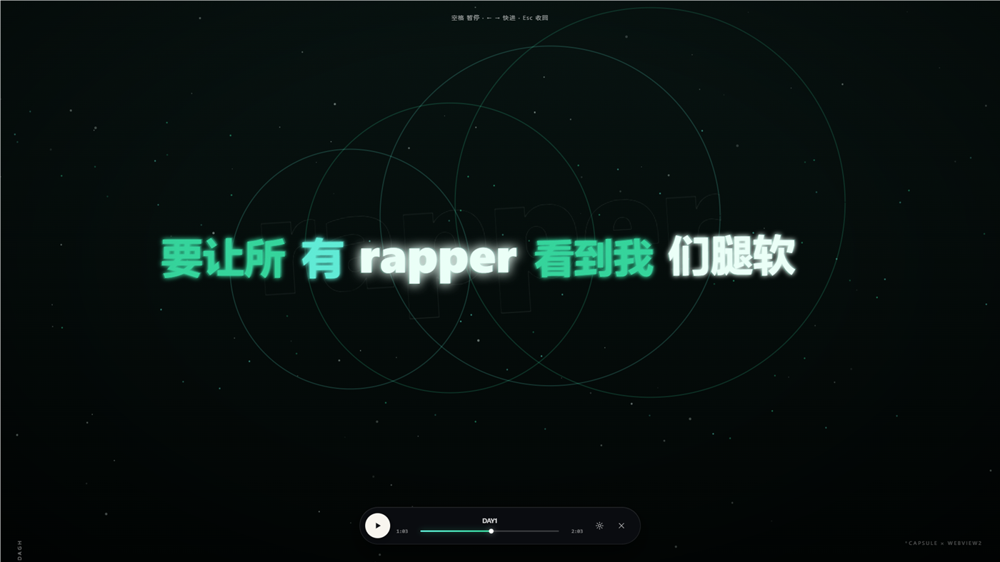

# 万象岛 Pro · Myriad Isle Pro

> 🌐 官网：**https://pl514.github.io/myriad-isle-web/** —— 功能详解、截图、下载都在这里。


> 一个常驻屏幕顶部的 Windows「动态岛」胶囊：截图、编辑、翻译、看抖音、听音乐，全都从这颗胶囊里长出来。



<p align="center">
  
  
  
  
  
</p>

---

## 这是什么

**万象岛 Pro** 是一个常驻桌面顶部的胶囊小条，像手机上的「灵动岛」：

- 你截图，它把图片**吸进胶囊**，点开就能看、能编辑、能直接拖到微信 / QQ / 文件夹
- 你按热键，它变成**框选翻译**，框住哪里就翻译哪里
- 你点一下，它能**长出抖音小窗**、**音乐面板**，甚至把歌词投到桌面

不需要安装：下载 → 解压 → 双击 exe。所有数据都在你自己电脑上。

> 这是 **Pro 版**（带抖音小窗 / 音乐 / AI 面板）。想要更轻的版本，看 [万象岛 标准版](https://github.com/pl514/myriad-isle)（单文件 486 KB，只有截图 / 编辑 / 翻译 / 提示 / 录屏）。

## 功能一览

| 模块 | 能做什么 |
| --- | --- |
| 📸 **截图** | 区域 / 窗口 / 全屏三种方式，截完自动落进胶囊 |
| 🖼️ **图片管理** | 胶囊里横向排列，悬停放大，单击预览，右键菜单，可拖拽到其它程序，可「钉」在桌面 |
| ✏️ **图片编辑** | 矩形、椭圆、箭头、画笔、荧光笔、文字、气泡、步骤序号、模糊、马赛克、裁剪、撤销重做 |
| 📝 **文字** | 复制任何文字，自动收进胶囊；可复制、收藏、清空、一键翻译 |
| 🌐 **翻译** | 文本翻译 + **屏幕框选翻译**；引擎可切：免费 MyMemory / 自己的 AI 模型 |
| 🎵 **音乐** | 内置播放器，多平台音源，播放队列、封面、歌词；**歌词可投射到桌面** |
| 📱 **抖音小窗** | 网页版抖音装进独立置顶小窗，刷完即走 |
| 💬 **微信 / QQ 提示** | 有消息时胶囊右侧冒出提示条，点击直达对应聊天窗口 |
| 🎬 **录屏** | 一键录制 MP4（需本机有 ffmpeg，或把 ffmpeg.exe 放到程序目录） |

## 界面展示

### 胶囊本体

<p align="center">
  
</p>

顶部一条窄窄的玻璃质感小条，平时不挡视线。鼠标移上去、或者按热键，就展开成面板。

### 展开后的面板

面板分三个页签：**图片 / 文字 / 翻译**，右边一排是操作按钮（清空、添加图片、关闭）。
图片以卡片形式横向排列，滚轮翻页，单击预览，右键出菜单。

### 音乐面板

<p align="center">
  
</p>

### 桌面歌词

按一下，整块屏幕就变成歌词画布：背景淡化、歌词逐字高亮、底部留一条毛玻璃播放条
（`空格` 暂停 · `← →` 快进 · `Esc` 收回）。

<p align="center">
  
</p>

### 胶囊里的迷你播放器

<p align="center">
  
</p>

## 下载与安装

**去 [Releases](https://github.com/pl514/myriad-isle-pro/releases/latest) 下载最新 zip：**

```
1. 下载  MyriadIslePro-3.20.zip（约 0.8 MB）
2. 解压到任意文件夹（不建议放 C:\Program Files，普通权限更省事）
3. 双击  MyriadIslePro.exe
4. 看屏幕顶部：胶囊出现了
```

### 系统要求

| 项目 | 要求 |
| --- | --- |
| 系统 | Windows 10 / 11（64 位） |
| 运行时 | .NET Framework 4.8（Win10 1903+ / Win11 自带） |
| 网页内核 | Microsoft Edge WebView2 Runtime（Win11 自带；Win10 没有会提示安装） |
| 录屏 | 可选，需要 ffmpeg（放到程序目录或加入 PATH） |

### 关于杀毒软件

程序**没有购买代码签名证书**，所以首次运行 Windows Defender / 360 / 火绒可能拦一下。
处理方式：把解压后的整个文件夹加入信任，或对 exe 选择「仍要运行」。

## 五分钟上手

1. **截图**：`Ctrl + Alt + Shift + A` 框选一块区域，松手后图片进胶囊
2. **看 / 改**：单击胶囊里的图片 → 预览；点编辑图标进编辑器
3. **用**：直接把图片从胶囊**拖进微信 / QQ / 文件夹**，或右键「复制」
4. **翻译**：`Ctrl + Alt + Shift + F` → 框住要翻译的区域 → 自动识别并覆盖成中文
5. **玩**：点胶囊右边的 `•••` → 冒出三个球：抖音 / AI / 音乐

## 功能细节

### 截图

| 方式 | 说明 |
| --- | --- |
| 区域截图 | 框选任意区域，带放大镜辅助 |
| 窗口截图 | 自动识别鼠标下的窗口 |
| 全屏截图 | 一键全屏，支持多显示器 |

截图后**不弹窗打扰**，直接进胶囊；胶囊里显示缩略图，悬停放大预览。

### 图片编辑

打开任一图片 → 点「编辑」，工具都在左侧：

- **形状**：矩形、椭圆、箭头、直线
- **画笔**：自由手绘，可调粗细和颜色
- **荧光笔**：半透明高亮
- **文字**：单击落字，可拖动、可拉伸
- **气泡**：对话框样式
- **步骤**：①②③ 自动编号，做教程很方便
- **模糊 / 马赛克**：涂抹即打码
- **裁剪**：拖动边框裁剪
- **撤销 / 重做**：`Ctrl+Z` / `Ctrl+Y`

保存会覆盖原图，「另存为」会生成新文件。

### 翻译

两种用法：

- **文本翻译**：胶囊里点开「文字」页签，选一段 → 翻译
- **屏幕翻译**：热键框选屏幕区域 → OCR 识别 → 译文覆盖显示在原来的位置

引擎可选（设置里切换）：

| 引擎 | 说明 |
| --- | --- |
| MyMemory | 免费、无需配置，量大时可能限流 |
| 自定义 AI 模型 | 填入任意 OpenAI 兼容接口的 BaseURL / 模型 / Key（DeepSeek、智谱、Kimi 等都行） |

### 抖音小窗

点 `•••` → 抖音球 → 出现一个**横屏置顶小窗**，里面是网页版抖音。

- 窗口可拖动、可调大小
- 始终置顶，不会被别的窗口盖住
- 再点一次球就收起（不退出进程，下次秒开）
- 位置会记住

> 说明：这是把网页版抖音装进小窗，功能与网页版一致。

### 音乐面板

点 `•••` → 音乐球 → 展开播放器：

- 平台切换、歌单、搜索、播放队列
- 封面、歌词、进度条、音量
- **歌词投射**：把歌词变成桌面上的一层文字，多种样式
- 胶囊迷你态：收起后胶囊里显示一个小播放条

### 微信 / QQ 提示

当微信或 QQ 有**新消息**时：

- 胶囊右侧冒出一条提示，左边微信、右边 QQ
- 点击提示 → 直接跳到对应窗口
- 两个都有消息：左半边点开微信，右半边点开 QQ
- 只有一个有消息：点哪都是它

判断依据是**音频会话**（有声音才算"在响"），不会读取你的聊天内容。

### 录屏

按 `Ctrl + Alt + Shift + R` 开始 / 停止，输出到 `data\Recordings\录屏_时间戳.mp4`。

优先用 `ddagrab`（桌面复制，不闪烁），失败自动退回 `gdigrab`。

## 热键表

所有热键**都可以改**：托盘右键 → 热键设置。

| 功能 | 默认热键 |
| --- | --- |
| 显示 / 收起胶囊 | `Ctrl + Alt + Shift + Space` |
| 区域截图 | `Ctrl + Alt + Shift + A` |
| 窗口截图 | `Ctrl + Alt + Shift + 2` |
| 全屏截图 | `Ctrl + Alt + Shift + 3` |
| 收起 / 展开图片 | `Ctrl + Alt + Shift + H` |
| 开始 / 停止录屏 | `Ctrl + Alt + Shift + R` |
| 抖音小窗 | `Ctrl + Alt + Shift + D` |
| 屏幕翻译 | `Ctrl + Alt + Shift + F` |

## 数据与隐私

**所有数据都在本地，程序不会上传任何东西**（除了你主动使用的翻译服务）。

```
MyriadIslePro.exe
data\
├── images\        截图与图片
├── screenshots\   剪贴板里的图片
├── Recordings\    录屏
├── translate-img\ 图片翻译的临时结果
├── settings.txt   设置
└── hotkeys.txt    你改过的热键
```

- 想迁移？整个文件夹复制走就行（绿色软件）
- 想清空？删掉 `data\` 重新开始
- 开机自启：托盘菜单开关，写当前用户注册表 Run 项，不弹 UAC

## 常见问题

<details>
<summary><b>双击没反应 / 一闪而过</b></summary>

通常是杀软拦截或 WebView2 运行时缺失。先看有没有弹窗；没有的话把整个文件夹加入信任，再确认系统装了 WebView2 Runtime。
</details>

<details>
<summary><b>拖图片到微信失败</b></summary>

Windows 不允许低权限进程给高权限进程拖文件。请**用普通权限运行本程序**（不要右键「以管理员身份运行」），也不要在低权限沙箱 / 远程桌面里启动。
</details>

<details>
<summary><b>翻译报「配额用完」</b></summary>

MyMemory 免费额度按天算。等一会儿，或在设置里换成自己的 AI 模型（DeepSeek、智谱等都有免费额度）。
</details>

<details>
<summary><b>热键没反应</b></summary>

可能被别的软件占用（输入法、录屏软件等）。托盘右键 → 热键设置里换一个组合，程序会提示是否注册成功。
</details>

<details>
<summary><b>录屏是黑屏</b></summary>

部分游戏 / 受保护窗口禁止桌面复制。可切换录制模式，或换较新版本的 ffmpeg。
</details>

## 从源码构建

不需要 Visual Studio，也不需要 NuGet：

```powershell
.\Build.ps1
```

需要 .NET Framework 4.8 自带的 `csc.exe`（Windows 一般都有）。产物固定输出到 `build\MyriadIslePro.exe`，同时把 `vendor\webview2` 里的运行库复制过去。

技术栈：

| 部分 | 技术 |
| --- | --- |
| 界面 | WPF（.NET Framework 4.8）+ 自绘动画 |
| 网页内容 | WebView2（抖音小窗、AI 网页后端、音乐网页端） |
| 截图 | GDI / Desktop Duplication |
| 录屏 | ffmpeg（ddagrab / gdigrab） |
| OCR | Windows.Media.Ocr（WinRT） |
| 系统集成 | P/Invoke（SetWindowPos、DwmSetWindowAttribute、音频会话 API） |

### 打发布包

```powershell
.\Publish.ps1                 # 读 src\AppInfo.cs 里的版本号
.\Publish.ps1 -Version 3.21   # 或手动指定
```

输出 `publish\万象岛-Pro-<版本>.zip`，含 exe、WebView2 运行库与使用说明。

## 更新日志

见 [Releases](https://github.com/pl514/myriad-isle-pro/releases)。

## 致谢

- 截图 / 贴图交互的早期思路参考了 [PicRope](https://github.com/Renly1994/PicRope) 与 [Tendedero](https://github.com/alejandrobujan/tendedero)
- WebView2 由 Microsoft 提供
- 感谢所有提建议、报 bug 的朋友

## 许可与免责

本项目使用 [MIT](LICENSE) 许可。

使用前请阅读 **[免责声明](DISCLAIMER.md)**，想参与开发看 **[贡献指南](CONTRIBUTING.md)**。

---

<p align="center">
  <sub>万象岛 Pro · 让截图不再打断你的工作流</sub>
</p>
